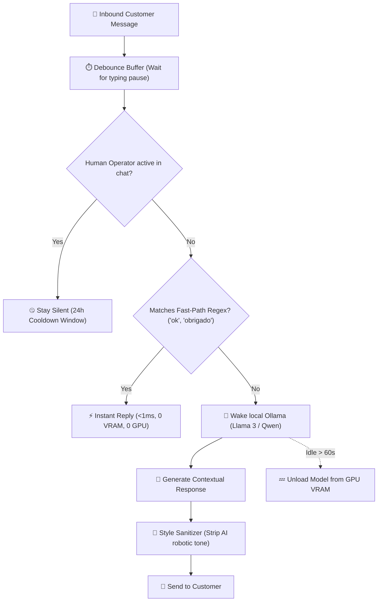

# 🤖 AI Support Agent (aisupport)

### Deterministic + Local LLM Customer Support Framework with Zero-VRAM Idle & HITL Silence

[](https://python.org)
[](https://github.com/Kaio-Comk/AI-Support-Agent)
[](https://ollama.ai)
[](https://opensource.org/licenses/MIT)

**Production customer support engine for Telegram, WhatsApp, and Web Chat.**  
*Combines sub-millisecond deterministic fast-paths with local LLMs (Ollama), automated VRAM unloading on idle, and Human-in-the-Loop (HITL) silence windows.*

---

## 🏗️ Architecture



---

## 📦 Installation

```bash
pip install git+https://github.com/Kaio-Comk/AI-Support-Agent.git
```

---

## 🚀 Quickstart

```python
from aisupport import FastPathMatcher, HITLSilenceTracker, DebounceBuffer, StyleSanitizer

# 1. Fast-path check
matcher = FastPathMatcher()
if canned := matcher.match("valeu!"):
    print(f"Replied without LLM: {canned}")

# 2. Human-in-the-Loop tracking
hitl = HITLSilenceTracker(cooldown_hours=24.0)
if human_sent_message:
    hitl.record_human_intervention(chat_id)
```

---

## 🛡️ License

MIT License. Extracted and decoupled from the NetHub customer support automation engine.
